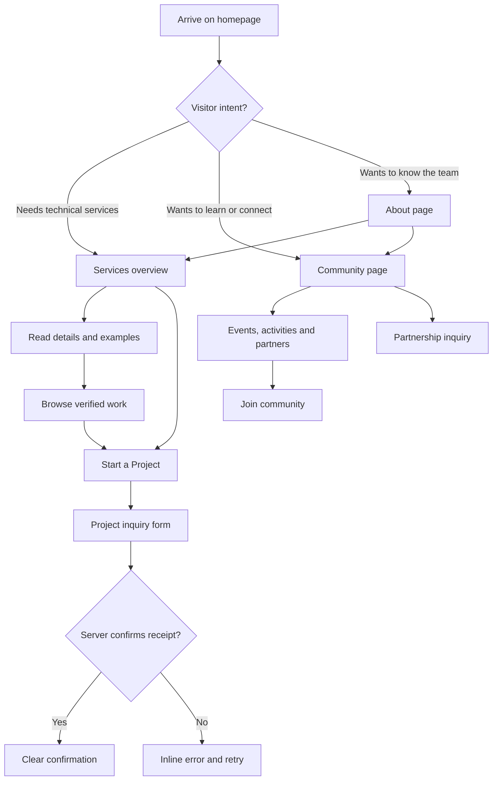
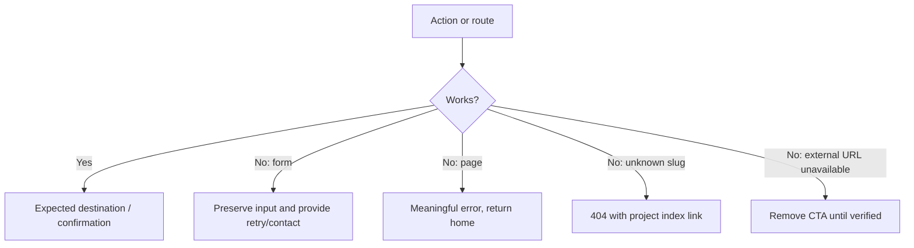

# Codrithm — App Flow & Interaction Specification

**Version:** 2.0 | **Updated:** 2026-10-10

This document covers public site routes, conversions, interaction states and failures. Follow `PRD-AND-TECHNICAL-REQUIREMENTS.md` for scope and `DESIGN-BRIEF.md` for appearance.

## 1. Two intentionally different user journeys



No mixed CTA semantics: **Start a Project** means business inquiry; **Join Community** means genuine membership route; **Partner With Us** means collaboration, not a project sales contact.

## 2. Sitemap / navigation

```text
/
├── /services
├── /projects
│   └── /projects/:slug   [only verified published projects]
├── /community
├── /about
├── /contact?type=project&service=ai-automation
├── /contact?type=partnership
├── /contact?type=general
├── /privacy
└── 404
```

Navigation: Home, Services, Projects, Community, About, Contact. Desktop CTA: Start a Project. Mobile: same destinations in a menu. Footer: these pages, approved social links, privacy and any appropriate real contact destination.

## 3. Homepage visitor path

```text
Hero: practical service positioning
  ├─ Start a Project → /contact?type=project
  ├─ Explore Our Work → /projects
  └─ Explore Community → /community
↓
Services: 4 cards → /services (relevant anchor) or contact with service preselected
↓
Selected Work: real projects → /projects/:slug
↓
How We Work: realistic process → /contact?type=project
↓
Community teaser: Learn · Build · Connect → /community
↓
Verified collaborators → respective approved partner pages, if links exist
↓
FAQ: practical objections → /contact
↓
Final CTA: project form + secondary community link
```

Always retain meaningful keyboard and mobile navigation to bypass long pages.

## 4. Client inquiry flow

1. User chooses service from navbar, card, project CTA or hero.
2. Contact route accepts whitelisted `type` and `service` query parameters; invalid values ignored safely.
3. Selects Project inquiry (or arrives preselected).
4. Form collects required name/email/description/consent, plus optional company, service and budget range. Clearly identify optional fields.
5. Client validates format and gives accessible inline errors; server validates all submitted fields and anti-spam controls.
6. Disable repeated submits while pending; show accessible progress/status message.
7. Send through approved server-side provider/endpoint; delivery must be verified.
8. On success show “Thanks — your inquiry was received” with realistic next-step copy. Never guarantee a response time unless team has approved it.
9. On failure retain values and show “Your message wasn't sent. Please retry or contact us at [verified email].”
10. Record minimal operational event without personal message text, only if privacy plan allows.

### Form state table

| State | Expected behavior |
|---|---|
| Initial | Empty or safe preselected service; labels and consent visible |
| Invalid | Field-specific text error; error summary/focus where suitable |
| Submitting | Prevent duplicate submissions; keep content accessible |
| Success | Only after true success; confirmation; optional reset |
| Network/provider error | Preserve form values; show retry/fallback |
| Rate limited | Inform user neutrally and suggest later/email |
| Delivery not configured | No fake submit; clearly explain alternate contact |

## 5. Community journey

1. User opens `/community` from nav, hero card, or footer.
2. Sees factual mission and actual Learn / Build / Connect opportunities.
3. Explores real event summaries, event photos, recording links, and approved collaborations.
4. User selects **Join Community** and opens the **verified, maintained joining destination**. External destination should indicate it opens a different service where helpful.
5. If no verified joining URL is configured, replace action with a truthful alternate contact route rather than a broken button.

**Event card states:** `Upcoming` only if event date is future and details approved; otherwise `Past` or no temporal label. Never auto-promote a past event because page data is stale.

## 6. Partner inquiry journey

Community/About → Partner with Us → `/contact?type=partnership` → organization/intent details → validated secure delivery → genuine confirmation/error. Partner logos can only be shown with real partner status and permission; distinguish institutional relationships from paying customers.

## 7. Projects journey

`/projects` → scan actual work and clear classification → choose project → `/projects/:slug` → problem, contribution, screenshots, tools, limitations/current status → relevant Services / Contact CTA.

- Do not show empty case studies or automatically generate generic fake projects.
- If only 1 project is approved, show 1 rather than three filler tiles.
- Unknown/unpublished slugs return a 404 experience, not a blank page.
- External links are visible only if approved and working; show repository links only when public.

## 8. FAQ and other states

| Element | Behavior |
|---|---|
| Navigation | Current route indication; mobile closes on selection/Escape; proper focus management |
| Hero CTAs | Keyboard accessible links to real destinations; stable visible copy |
| Service cards | Entire card need not be clickable; obvious text link with correct accessible name |
| Accordion | Enter/Space toggle; accurate aria state; content stays accessible |
| Logo strip | Pause on hover/focus if scrolling; static in reduced-motion mode |
| Carousels (if retained) | Manual controls, accessible labels, avoid unsolicited auto movement |
| Toast/alerts | Appropriate polite/error live region; not sole source of critical feedback |
| External URLs | Verified target, no dead anchor/`#` placeholders |
| Loading | Real content does not disappear behind animation |

## 9. Failure and recovery flows



## 10. Device/accessibility flow tests

- Keyboard: skip link → nav → first CTA → service cards → accordion → footer; visible focus throughout.
- Screen reader: logical heading outline, informative control names, errors announced.
- 320px: no overflow, legible copy, working menu, tap targets >=44px where practicable.
- 375/768/1024/1440: layout responds without cropped cards, awkward text wrap or image distortion.
- Reduced-motion setting: every task reachable without entrance animation or marquee.
- Slow network: forms do not double-send; navigation remains responsive.

## 11. Acceptance scenarios

- A prospect seeking WordPress sees a clear offering, reads work examples, and submits a service-prefilled inquiry that reaches an approved destination.
- Someone seeking AI automation can understand specific work without vague promises and contact Codrithm.
- A student can locate the Community page and follow a verified join path without being diverted through a sales form.
- A partner can submit a partnership inquiry distinct from a project lead.
- A visitor can understand whether a featured project is client work, an internal prototype, or community work.
- A failed contact submission never falsely claims success.
